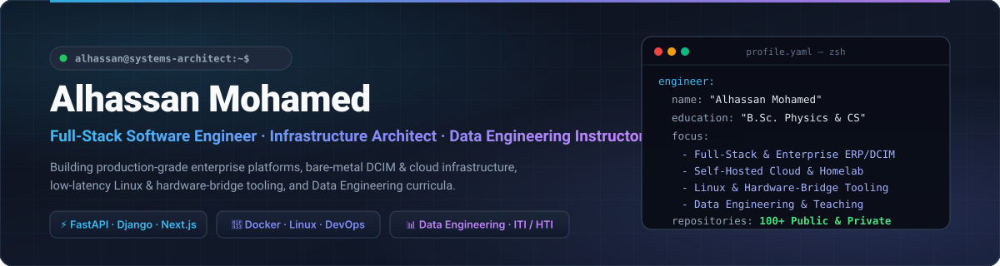

  

  

  
  
  
  

---

## 👨‍💻 Executive Profile

I am a **Full-Stack Software Engineer**, **Systems & Infrastructure Architect**, and **Data Engineering Instructor** with a **B.Sc. in Physics & Computer Science** (Zagazig University). Across **100+ repositories**, my work spans production-ready enterprise platforms, bare-metal data center management, self-hosted cloud infrastructure, low-latency Linux/Android hardware bridges, and university/institute Data Engineering curricula.

- 🏗️ **Enterprise & Cloud Systems:** Architecting end-to-end platforms using **FastAPI**, **Django REST Framework**, **Next.js (App Router)**, **React 19**, **TypeScript**, **PostgreSQL/MySQL**, and **Redis/Celery** — from bare-metal server provisioning (**AuraMetal**) and data center operations (**Datacenter ServerOps**) to ERP quotation engines (**CateSys**) and enterprise project management (**CompanySYS**).
- 🐧 **Linux, DevOps & Self-Hosted Infrastructure:** Designing memory-budgeted containerized stacks (**Docker Compose**, **Nextcloud + Collabora** with real-time forensic auditing, **Prometheus/Grafana** observability, **Jenkins** CI/CD) and native Linux/GNOME extensions.
- ⚡ **Low-Latency Hardware & Developer Tooling:** Building real-execution developer sandboxes (**Mainline** interactive Git/GitHub platform) and zero-latency USB bridges that turn Android devices into hardware-accelerated H.264 webcams (**USB Phone Cam**) and click-through PC stylus digitizers (**USB Tablet Annotator**).
- 🎓 **Data Engineering & Technical Instruction:** Delivering hands-on **Database Design, SQL Optimization, and Python Data Engineering** curricula for **ITI (Information Technology Institute)** and **HTI** Summer Training cohorts.

---

## 🏛️ Core Engineering Domains

<table>
  <tr>
    <td width="50%" valign="top">
      <h3>🏢 Enterprise Full-Stack &amp; ERP/DCIM</h3>
      <ul>
        <li>Multi-tier <b>Role-Based Access Control (RBAC)</b> &amp; JWT security</li>
        <li>Asynchronous task orchestration with <b>Celery &amp; Redis</b></li>
        <li>Real-time telemetry via <b>WebSockets &amp; Server-Sent Events (SSE)</b></li>
        <li>Automated PDF quotation engines, Arabic/English <b>Tesseract OCR</b> invoice pipelines, and live GPS fleet tracking</li>
      </ul>
    </td>
    <td width="50%" valign="top">
      <h3>☁️ Self-Hosted Cloud, DevOps &amp; Homelab</h3>
      <ul>
        <li>Strict resource-budgeted container orchestration (<b>Docker Compose</b>)</li>
        <li>Forensic file audit trails (<i>Who-Did-What-When</i> &amp; rename lineage)</li>
        <li>20+ self-hosted homelab microservices (<b>Gogs</b>, <b>Jitsi</b>, <b>Prometheus</b>, <b>Grafana</b>, <b>Jenkins</b>, autonomous AI agents)</li>
        <li>Remote Linux server file-system &amp; shell management APIs</li>
      </ul>
    </td>
  </tr>
  <tr>
    <td width="50%" valign="top">
      <h3>🔧 Developer Tools, Linux &amp; Hardware Bridges</h3>
      <ul>
        <li>Interactive sandboxed <code>git</code> &amp; <code>gh</code> execution engines</li>
        <li>Zero-latency <code>adb reverse</code> USB tethering with <b>WebCodecs (H.264)</b></li>
        <li><b>PyQt5</b> transparent click-through desktop overlays for stylus input</li>
        <li><b>GNOME Shell</b> hardware telemetry extensions (<code>hwmon</code>, <code>nvidia-smi</code>) &amp; Chromium download/media bridges (<code>yt-dlp</code> + Motrix)</li>
      </ul>
    </td>
    <td width="50%" valign="top">
      <h3>📊 Data Engineering, AI &amp; Instruction</h3>
      <ul>
        <li>Instructor for <b>ITI &amp; HTI Summer Data Engineering</b> tracks (2025–2026)</li>
        <li>Relational schema modeling, indexing, &amp; complex SQL analytics</li>
        <li>End-to-end <b>Python / Jupyter</b> data analysis, A/B testing &amp; EDA</li>
        <li>Applied Computer Vision, Deep Reinforcement Learning, &amp; C#/UiPath RPA</li>
      </ul>
    </td>
  </tr>
</table>

---

## 🚀 Flagship Engineering Projects

### 1. Enterprise Platforms, Cloud Infrastructure & Developer Tools

| Project | Architectural Highlights & Capabilities | Tech Stack |
| :--- | :--- | :--- |
| **[Mainline](https://github.com/alhassanmohamed2/mainline)** Interactive Git & GitHub Platform | Executes real `git` and `gh` commands inside an isolated local disk sandbox and redraws the working tree, staging index, commit DAG, and remote history in real time across 8 interactive chapters with terminal autocomplete and search palette. | `TypeScript` `React` `Node.js` `Tailwind CSS` `Git CLI` |
| **[AuraMetal Servers](https://github.com/alhassanmohamed2/aurametal-servers)** Bare-Metal Provisioning & DCIM | Production-grade Bare-Metal Provisioning & Data Center Infrastructure Management (DCIM) platform with 4-tier RBAC (`ADMIN`, `IT_SUPPORT`, `HARDWARE_TEAM`, `CUSTOMER`), automated OS deployment workflows (Ubuntu/Debian/Rocky), SSE notifications, and a secure root credential vault. | `Next.js 15` `React 19` `FastAPI` `Async SQLAlchemy` `MySQL 8` `Redis` `Celery` `Docker` |
| **[Data Vault Drive](https://github.com/alhassanmohamed2/data-vault-drive)** Self-Hosted Cloud Drive & Audit Suite | Complete Google Drive & Docs alternative engineered for a strict **4 vCPU / 8 GB RAM VPS** (5–50 users). Integrates Nextcloud + Collabora Online with real-time **Who-Did-What-When** forensic audit logging, version history, and rename-aware edit lineage tracking. | `Nextcloud` `Collabora` `PostgreSQL` `Redis` `Docker` `JavaScript` |
| **[Datacenter ServerOps](https://github.com/alhassanmohamed2/datacenter-system)** Data Center Operations & IPAM | Full-stack operations platform enabling IT and network engineering teams to manage server racks, exact U-space allocations, IP address pools, SLA compliance metrics, and support ticketing. | `Next.js` `Django REST` `PostgreSQL` `Tailwind CSS` `Docker` |
| **[CompanySYS](https://github.com/alhassanmohamed2/companySYS)** Enterprise Project Management | Multi-role enterprise project management suite featuring customizable role dashboards, interactive Kanban workflows, live GitHub repository integration, background job queues, and real-time notifications. | `Django 6` `DRF` `React 19` `TypeScript` `Tailwind v4` `MySQL 8` `Celery` `Redis` |
| **[Secure Exam IDE](https://github.com/alhassanmohamed2/Secure-Exam-IDE)** Anti-Cheat Coding Assessment Platform | High-security web-based programming examination system built on **Judge0 CE** & **Monaco Editor**. Enforces fullscreen lock, tracks window-blur/tab-switch violations with countdown penalties, auto-submits flagged attempts, and centralizes instructor grading. | `Node.js` `Express` `Judge0 CE` `Monaco Editor` `PostgreSQL` `Docker` |
| **[Shift Management System](https://github.com/alhassanmohamed2/shift-mangement)** Interactive IT Operations Scheduler | Visually rich IT support shift scheduler featuring an animated live office scene with active character avatars, drag-and-drop weekly roster assignment, inline validation, shift swap workflows, and JWT audit logs. | `Next.js 14` `Framer Motion` `FastAPI` `PostgreSQL` `Tailwind CSS` |

### 2. Linux Desktop, Hardware Bridges & Self-Hosted Homelab

| Project | Architectural Highlights & Capabilities | Tech Stack |
| :--- | :--- | :--- |
| **[USB Phone Cam](https://github.com/alhassanmohamed2/USB-Phone-Cam)** Zero-Latency Android USB Webcam | Turns any Android phone into a high-definition, near-zero-latency USB webcam for OBS and Linux/Desktop using `adb reverse` USB tethering and hardware-accelerated **WebCodecs (H.264)** streaming with focus/exposure lock. | `Python` `ADB` `WebCodecs (H.264)` `HTML5` `JavaScript` |
| **[USB Tablet Annotator](https://github.com/alhassanmohamed2/USB-Tablet-Annotator)** Android Stylus-to-PC Screen Digitizer | Transforms an Android stylus tablet (e.g., Huawei MatePad PaperMatte) into a direct PC screen digitizer over USB (`adb reverse`), rendering a click-through transparent **PyQt5** overlay for real-time desktop annotation. | `Python` `PyQt5` `ADB` `WebSockets` `Linux/Desktop` |
| **[GNOME Fan Speed Indicator](https://github.com/alhassanmohamed2/Gnome-FanIcons)** ⭐ Linux Hardware Telemetry Extension | GNOME Shell top-bar extension displaying smoothly rotating CPU & GPU fan icons whose angular velocity maps in real time to physical RPM and thermal sensors via `hwmon` sysfs, `lm-sensors`, and `nvidia-smi`. | `JavaScript (GJS)` `GNOME Shell` `Linux hwmon` `nvidia-smi` |
| **[Motrix Browser Extension](https://github.com/alhassanmohamed2/Motrix-browser-Extension)** ⭐ Smart Download & Video Bridge | Chromium extension integrating browser download interception and one-click `yt-dlp` video extraction (YouTube, X/Twitter, etc.) directly into the Motrix download manager via Aria2 RPC. | `JavaScript` `Chrome Extension API` `Aria2 RPC` `yt-dlp` |
| **[Homelab Projects Suite](https://github.com/alhassanmohamed2/home-lab-projects)** & **[DebianManager](https://github.com/alhassanmohamed2/DebianManger)** 20+ Self-Hosted Services & AI Agents | Complete self-hosted server ecosystem: **ALTupe** (FastAPI/React video platform), **CentralAgent** (Jenkins CI/CD controller), **alhassanAgent** & **market_agent** (autonomous AI agents), **server-dashboard** (Prometheus + Grafana), self-hosted **Gogs** Git, **Jitsi Meet**, LTE modem telemetry, and FastAPI Debian file manager. | `FastAPI` `React` `Docker Compose` `Prometheus` `Grafana` `Jenkins` `Linux` |

### 3. Data Engineering Instruction, Applied AI & Commercial Systems

| Project / Initiative | Scope & Impact | Tech Stack |
| :--- | :--- | :--- |
| **[ITI & HTI Data Engineering Curriculum](https://github.com/alhassanmohamed2/ISM_SUM_Data-Engineering---1---HTI--July-2026)** ⭐⭐⭐⭐⭐ [HTI July 2026 (★5)](https://github.com/alhassanmohamed2/ISM_SUM_Data-Engineering---1---HTI--July-2026) · [ITI Summer 2025 (★3)](https://github.com/alhassanmohamed2/ISM_ITI_Sum2025_Data-Engineering) · [HTI DB Course](https://github.com/alhassanmohamed2/Data-Engineering-HTI) | Designed and delivered comprehensive coursework, database architecture labs, EER modeling, SQL optimization exercises, and Python/Jupyter Data Engineering modules for **Information Technology Institute (ITI)** and **HTI** summer cohorts. | `Python` `MySQL` `SQL` `Jupyter Notebook` `DBeaver` `Database Design` |
| **Enterprise ERP, Fleet & OCR Suite** CateSys ERP · Driver Tracking · ETA Invoice OCR | Architected **Cate ERP** (containerized sales & equipment quotation platform inspired by Atlas Copco workflows), **Driver Tracking System** (bilingual English/Arabic real-time GPS fleet & delivery platform), and **ETA Invoice Reader** (Arabic/English PDF invoice OCR extraction & Excel export pipeline). | `FastAPI` `React 18` `TypeScript` `SQLAlchemy` `Tesseract OCR` `Python` `Docker` |
| **Applied ML, Scientific Computing & Mobile** [CastingMetals](https://github.com/alhassanmohamed2/CastingMetals) · [Analyze_AB_Test](https://github.com/alhassanmohamed2/Analyze_AB_Test) · [EasyCharge](https://github.com/alhassanmohamed2/easycharge) · [SpaceApps](https://github.com/alhassanmohamed2/SpaceApps) | Built a NASA Space Apps project (**SpaceApps**), automated gating-system metallurgy calculations (**CastingMetals**), physics simulations, statistical A/B test pipelines, Computer Vision / Deep RL models, and cross-platform **Flutter/Dart** mobile apps (**EasyCharge**). | `Python` `Scikit-Learn` `PyTorch` `Flutter / Dart` `PHP / Laravel` `C# / RPA` |

---

## 🛠️ Technical Arsenal

**Languages & Core Runtimes**
 

**Backend, Frontend & Cross-Platform Frameworks**
 

**Databases, Caching, DevOps & Infrastructure**
 

---

## 📈 GitHub Telemetry & Contribution Activity

  

  
  

  

---

  ⚡ Crafted to reflect real-world systems engineering, open-source tooling, and technical mentorship — <b><a href="https://github.com/alhassanmohamed2">Alhassan Mohamed</a></b>

